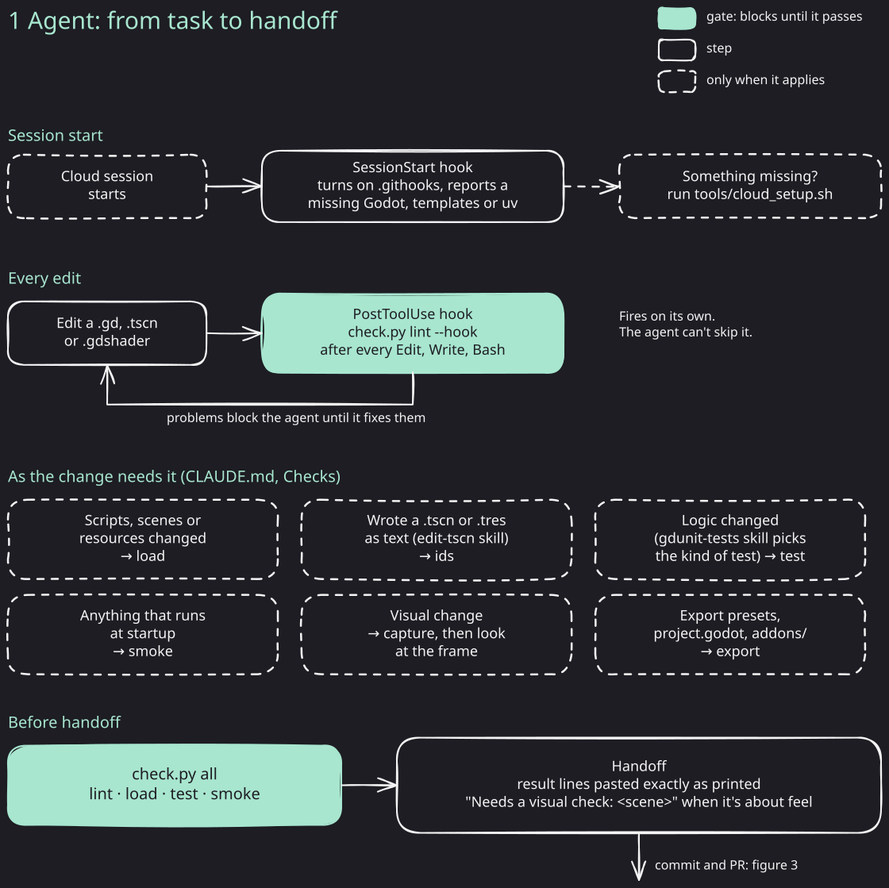
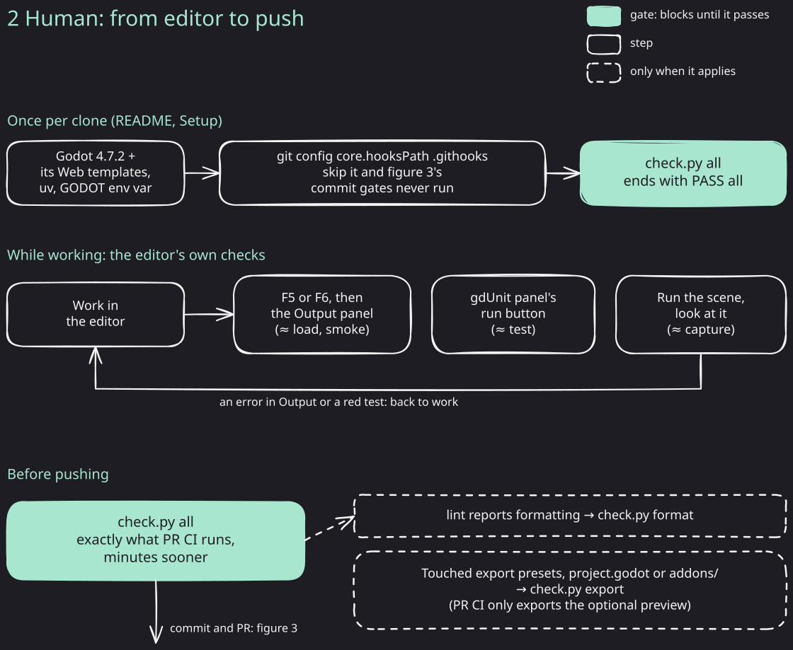
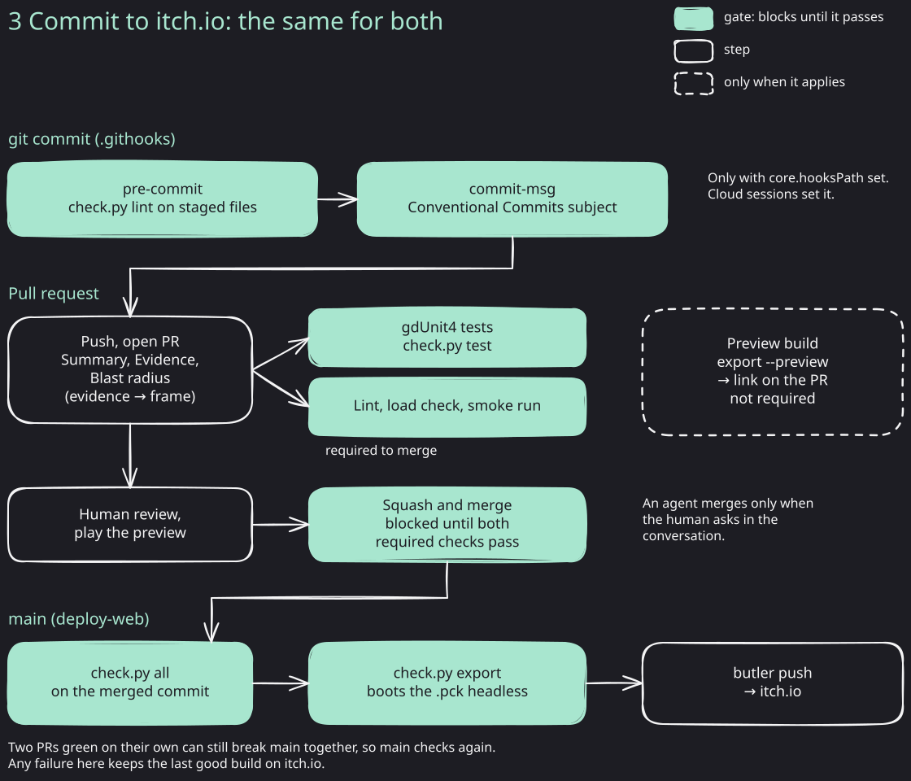

# Dev flow

Where each check runs on the way from a change to itch.io, for an agent and for a human. The commands themselves are in README.md, Checks.

Mint boxes are gates: nothing moves on until they pass. Dashed boxes apply only to some changes.

## 1. Agent

The lint hook is the only check the agent can't skip. The rest it runs because CLAUDE.md tells it to, so the handoff must paste the `check.py all` result lines as printed.

## 2. Human

Run `uv run tools/check.py all` before pushing. It is the same run as the PR's required checks, so a pass here means CI passes unless main moved. Before merge, only the optional preview build exports the game, so a change to export presets, `project.godot` or `addons/` also needs `uv run tools/check.py export`. Otherwise the break first shows up when the deploy on main fails.

## 3. Commit to itch.io

## Editing the figures

Open a `.excalidraw` file at [excalidraw.com](https://excalidraw.com), edit it, save it back over the file, then export it as SVG over the `.svg` beside it with Background on, Dark mode off and Embed scene off. Use only the three colors already in the figure: the background `#1d1d23`, white `#f4f4f5` and mint `#a8e6cf`. Text on a mint box uses the background color.
